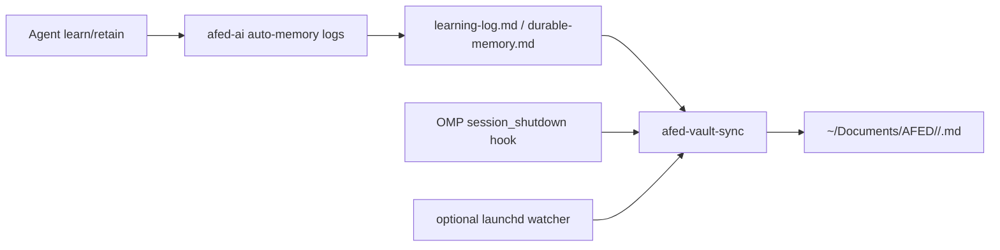

# afed-vault-sync automation

Use this skill when you need to keep the Obsidian vault at `~/Documents/AFED` in sync with session memory produced by the AI agent, or when debugging why vault notes did not update.

## Architecture



- `afed-ai` auto-memory writes local markdown logs.
- `afed-vault-sync` parses those logs, classifies project/topic, and writes or updates vault notes.
- Deduplication is by content hash; state is stored in `~/.local/share/afed-vault-sync/processed.json`.
- The OMP session shutdown hook starts a one-shot sync when a session exits.
- The launchd watcher remains optional for periodic polling.

## Locations

- Sync repo: `/Users/fikrimastor/Sites/afed-vault-sync/`
- Config: `~/.config/afed-vault-sync.yaml`
- OMP hook: `~/.omp/agent/hooks/pre/afed-vault-sync-on-shutdown.ts`
- Hook log: `~/.local/share/afed-vault-sync/session-shutdown.log`

## Commands

```bash
cd /Users/fikrimastor/Sites/afed-vault-sync

# One-shot sync
./.venv/bin/python3 -m afed_vault_sync.cli --verbose sync

# Dry run
./.venv/bin/python3 -m afed_vault_sync.cli --dry-run --verbose sync

# Continuous watcher
./.venv/bin/python3 -m afed_vault_sync.cli watch
```

## Configuration

Config file: `~/.config/afed-vault-sync.yaml`

```yaml
vault_root: ~/Documents/AFED
memory_root: /Users/fikrimastor/Sites/afed/.claude-assistant/afed-ai/ai-assistant/memory
state_dir: ~/.local/share/afed-vault-sync
poll_interval_seconds: 300

default_status: COMPLETE

project_map:
  afed: AFED
  afedts: AFEDTS
  afedhome: AFED
  erp: ERP
  lodestar: Lodestar
  mcdynect: McDynect
  mcdynectdocs: McDynect Docs
  mrchurros-dash: Mr Churros Dash
  mrchurrosdash: Mr Churros Dash
  wordpress: WordPress
```

## OMP session_shutdown hook behavior

The hook registers `pi.on("session_shutdown", ...)`, creates `~/.local/share/afed-vault-sync/`, then starts the one-shot sync in the background:

```bash
cd /Users/fikrimastor/Sites/afed-vault-sync
nohup ./.venv/bin/python3 -m afed_vault_sync.cli --verbose sync >> ~/.local/share/afed-vault-sync/session-shutdown.log 2>&1 < /dev/null &
```

It returns quickly so OMP's 2-second shutdown handler cap does not block exit.

## macOS background service

Use only if periodic polling is wanted in addition to session shutdown sync:

```bash
cp /Users/fikrimastor/Sites/afed-vault-sync/com.afed.vault-sync.plist ~/Library/LaunchAgents/
launchctl load ~/Library/LaunchAgents/com.afed.vault-sync.plist
```

## Manual fallback

If the hook/watcher fails or the user needs an immediate human-readable note, use the `afed-vault-sync` skill and update the relevant Obsidian note directly.
